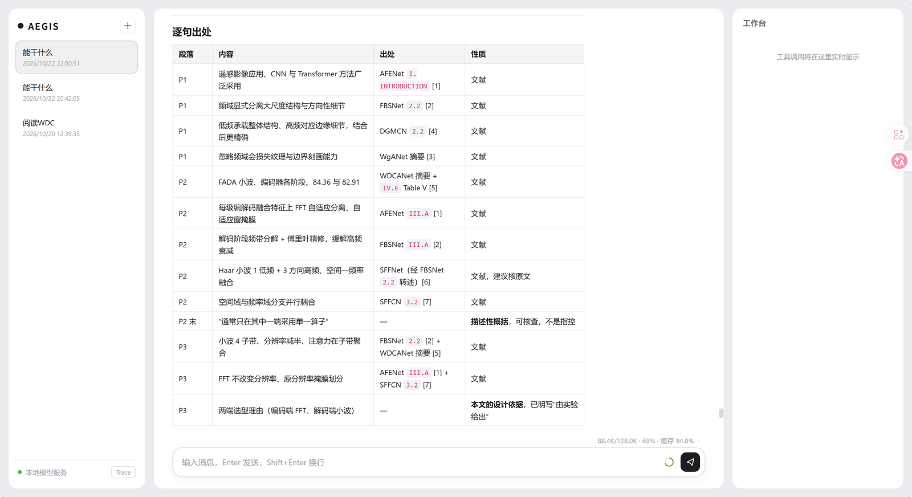

# AEGIS-Agent

> 一个会读论文的 LLM Agent —— 边学 agent 开发边做的个人项目。

给它一个装满论文的文件夹，它会自己把 PDF 解析成 Markdown、按章节拆开、挑重点读完，然后交给你结构化总结。
除此之外，它还能联网搜索、读写文件、执行命令、开子代理并行干活，通过 MCP 接入外部工具服务。

项目跑在本地，模型接口走 OpenAI 兼容格式。




---

## 它能做什么

**读论文** —— 给一个文件夹，走完「解析 → 切分 → 精读 → 总结」四步。
全文留在磁盘上，想深挖哪部分再按需取回。

**批量写报告** —— 一次处理整个文件夹，逐篇读完汇总成综述。

**联网搜索** —— 接 Tavily 查实时信息。

**文件与命令** —— 工作区内读写文件；执行命令前经 LLM 安全审查，权限限制在工作区。

**子代理** —— 复杂任务拆给子代理异步推进，主代理不必等它读完所有材料。

**接入外部工具MCP** —— 通过 MCP 协议把外部服务当工具用。仓库自带一个客户端的完整实现。


---

## 快速开始

### 环境要求

- Python 3.10+（开发环境为 3.12）

### 安装

```bash
git clone https://github.com/A51662B/AEGIS-Agent.git
cd AEGIS-Agent
pip install -r requirements.txt
```

### 配置

复制模板并填入你的 key：

```bash
cp .env.example .env
```

```ini
# 必填
OPENAI_API_KEY=your-api-key
OPENAI_BASE_URL=https://your-endpoint/v1

# 可选
CHAT_MODEL=deepseek-flash
REPORT_MODEL=
TITLE_MODEL=
CONTEXT_WINDOW=128000

# 用到对应功能才需要
TAVILY_API_KEY=
MINERU_API_TOKEN=
```

| 变量 | 必填 | 说明 |
|---|---|---|
| `OPENAI_API_KEY` | 是 | 模型 API Key |
| `OPENAI_BASE_URL` | 是 | 模型接口地址，需兼容 OpenAI 格式 |
| `CHAT_MODEL` | | 主对话模型，默认 `deepseek-flash` |
| `REPORT_MODEL` | | 报告工作流模型，缺省回落 `CHAT_MODEL` |
| `TITLE_MODEL` | | 会话标题模型，缺省回落 `CHAT_MODEL` |
| `CONTEXT_WINDOW` | | 上下文窗口大小，默认 128000，影响用量面板占比 |
| `TAVILY_API_KEY` | | 联网搜索 |
| `MINERU_API_TOKEN` | | PDF 解析（MinerU Standard API） |

### 运行

```bash
python server.py
```

打开 <http://127.0.0.1:8000>。支持流式输出、多会话、中断生成、一键压缩上下文、工具调用面板。

命令行也可以：

```bash
python main.py        # 同步
python async_main.py  # 异步，支持子代理
```

---

## 架构

```
浏览器
  │  SSE
  ▼
server.py（FastAPI）
  │  _agent_stream：每轮对话一个流
  ▼
ChatModel / async_ChatModel
  │  messages + tools → 模型
  ▼
ToolProxy.invoke(工具名, 参数)
  ├─ 普通工具      → 直接调用，同步返回
  ├─ 长任务工具    → spawn 后台 task，先回占位提示，结果进队列
  ├─ subAgent      → 独立 Memory + 独立上下文，结果回队列
  └─ MCP 工具      → await mcp.call(...)，服务端是独立进程
  │
  ▼
工具结果 → 写回 Memory → 下一轮或输出
```

三个值得说的设计：

**长任务不阻塞**：工作流类工具丢进后台 task，先给模型一句「任务运行中」，结果通过
`SubAgentMessageQueue` 回传。异常也必须 `q.put` 回队列，否则主循环会永远卡在 `await q.get()`。

**子代理上下文隔离**：`subAgent` 自己开一个 Memory，在里面读多少材料都行，最后只把一段文字还给主代理。
这是控制主上下文膨胀最有效的手段。

**工具可插拔**：`@tool(name, description)` 一行注册，参数 schema 从函数签名自动生成；
MCP 工具走另一条注册路径，模型看到的是同一份 `tools` 列表。

---

## 内置工具

模型可以自主调用这些工具：

| 工具 | 作用 |
|---|---|
| `pdfToMarkdown` | 调 MinerU 把目录下的 PDF 批量解析成 Markdown（保留正文与图片） |
| `splitPaper` | 把 `full.md` 按章节切分，生成章节清单（类别 + 标题 + 字符数） |
| `reportWorkflow` | 批量读论文并汇总成报告 |
| `skilltool` | 加载 `skills/` 下的技能手册，按手册流程执行 |
| `subAgent` | 开异步子代理处理子任务（不允许嵌套） |
| `web_search` | 联网搜索（Tavily） |
| `run_bash` | 执行命令，执行前经 LLM 安全审查，权限限制在工作区 |
| `list_directory` | 列出目录内容 |
| `read_file` | 读取文件 |
| `write_file` | 创建或覆盖文件 |
| `append_file` | 追加内容 |
| `replace_in_file` | 替换一段文字 |
| `get_current_time` | 当前日期、时间、星期 |

---

## 技能（skills）

`skills/` 下每个 `.md` 就是一份**写给模型看的操作手册**。模型不会一次读完所有手册，
而是通过 `skilltool` 按需加载——真要用到时才把完整流程取出来。

| 技能 | 什么时候用 |
|---|---|
| `read_paper` | 从 PDF 开始完整读一篇论文并输出结构化总结 |
| `rag_kb` | 需要知识库里的具体事实：数值、方法细节、实验结果 |
| `claim_check` | 交一段自己写的论述，要求核查依据并改写 |
| `style_rewrite` | 要求改善语言风格、润色、改成像论文的写法 |

新增技能只要丢一个 `.md` 进 `skills/`：

```markdown
# 这个技能是干什么的（第一行会成为描述，模型据此判断何时加载）

（下面写流程和规则）
```

第一行 `#` 后面的文字会自动进入 `skilltool` 的工具描述。

技能的调用时机由系统提示词控制（见 `server.py` 的 `MAIN_SYSTEM_PROMPT`）：
每个技能在提示词里都有一段触发条件，避免模型「看见工具就直接用、想不起来先读规则」。

---

## 接入外部工具（MCP）

`mcp_kit/` 是一个最小可用的 MCP 客户端：连接服务端、握手、取工具列表、调用工具。

```python
from mcp_kit import MCPManager

mgr = MCPManager(
    command=sys.executable,
    args=["D:/path/to/my-ragflow/mcp_server.py"],
    cwd="D:/path/to/my-ragflow",
    timeout=60,
)
await mgr.start()                          # 连接 + 握手 + 取工具列表
tools = mgr.to_openai_functions()          # 转成 toolregistry 认识的样子
result = await mgr.call("kb_search", {"query": "..."})
await mgr.stop()
```

接进 agent 的三个位置（见 `async_ChatModel.py`）：

1. `get_mcp()` —— 第一次请求前连接一次，工具描述 append 进 `tools`，名字记进 `MCP_TOOL_NAMES`
2. `invoke()` —— 命中 `MCP_TOOL_NAMES` 就走异步分支，带超时与异常捕获
3. `_agent_stream()` —— 每轮开头 `await get_mcp()`，幂等

注意：MCP 的包目录不能命名为 `mcp`，否则会遮蔽官方 SDK（Python 优先从当前目录找同名包）。
所以这里叫 `mcp_kit`。

---

## 项目结构

```
AEGIS-Agent/
├── server.py                  Web 入口（FastAPI + SSE）
├── main.py / async_main.py    命令行入口
├── ChatModel.py               模型调用 + 工具调度（同步）
├── async_ChatModel.py         模型调用 + 工具调度（异步，含 MCP 分发）
├── Memory.py                  会话记忆：持久化、压缩、检查点回滚
├── Message.py                 消息类型与格式转换
├── session_store.py           会话目录管理
├── session_context.py         当前会话的 contextvar
├── SubAgentMessageQueue.py    子代理结果队列
├── config.py                  模型名与上下文窗口配置
├── mcp_kit/                   MCP 客户端
├── tools/                     内置工具与注册表
├── workflow/                  LangGraph 工作流（PDF 解析 / 报告生成）
├── skills/                    技能手册
├── observability/             会话分析：加载、规则、查看器
├── utils/                     分词计数、标题生成、章节切分、子代理状态
├── static/                    Web 前端（含本地 KaTeX）
├── assets/                    README 用图
├── memory/                    会话数据（运行时生成，不入库）
└── workspace/                 工作区（运行时生成，不入库）
```

---

## 说明

- `memory/` 和 `workspace/` 是运行时目录，程序自动创建，不纳入版本控制。
- 模型接口走 OpenAI 兼容格式，理论上可接任何兼容服务。
- `static/vendor/` 里的 marked 和 KaTeX 是本地资源，离线也能渲染公式。
- 个人学习项目，还在持续完善中。

---

